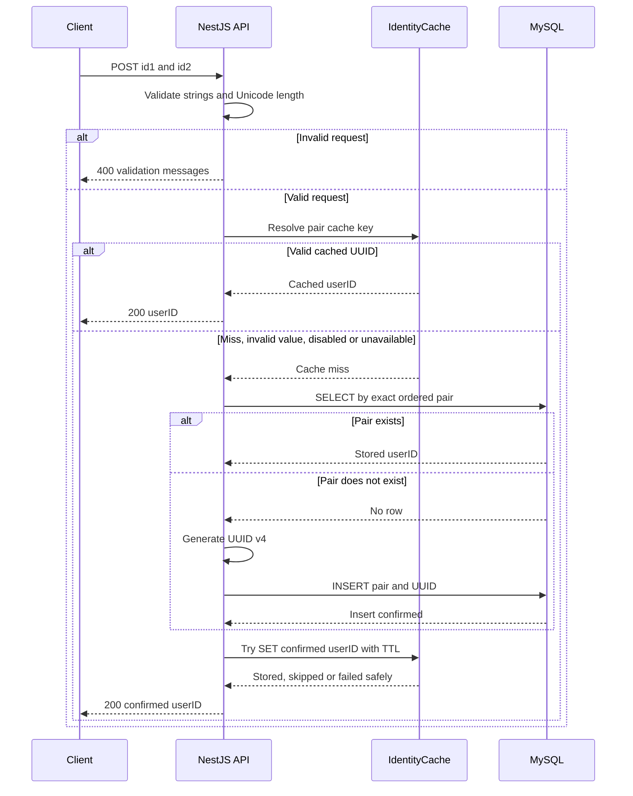
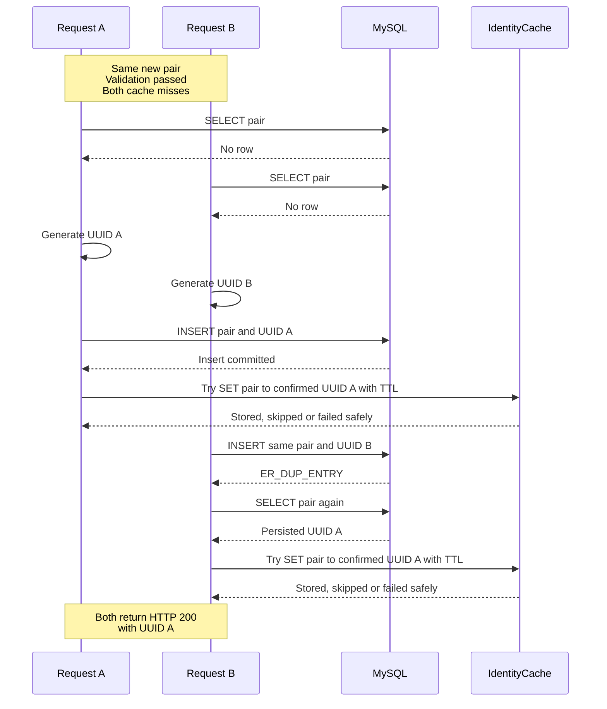

# Processing sequences

These diagrams describe `POST /users/resolve`. `IdentityCache` wraps the optional Redis connection. The first diagram shows sequential resolution; the second expands the insert race when two requests miss the same new pair. Return to the [README](../README.md) for setup, configuration and the API contract.

## Resolve a request

`IdentityCache` skips network I/O when disabled, unready or closing. A GET failure or local deadline is a miss; a SET failure is ignored after database success. A cache hit returns immediately without querying MySQL or extending the TTL.

An unrecovered database error ends resolution without a cache write. The exception filter returns `503` for recognized transient database failures and `500` for other unexpected failures, with no driver details in the response. The insert-conflict recovery path is shown below.

## Resolve concurrent first requests

The composite unique index on `(id1, id2)` selects one persistent mapping across application instances. Each request uses MySQL autocommit; no Redis lock or explicit transaction coordinates them. UUID B is never returned or cached.

Only a TypeORM-wrapped `ER_DUP_ENTRY` triggers the extra lookup. If that lookup finds no matching pair, the original duplicate error is rethrown; if the lookup fails, its error propagates. Neither case writes a tentative UUID to the cache.
